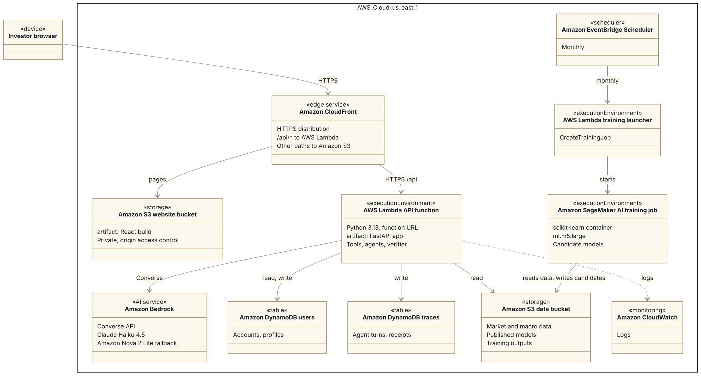
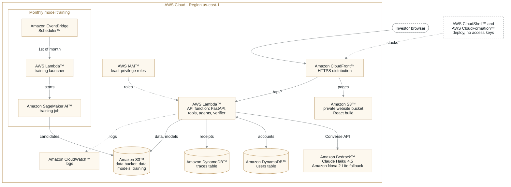

# WealthPilot on AWS

*Region us-east-1 (US East, N. Virginia). The services behind the live demo.* Educational simulation: fictitious allocations, no real trades, not personalized financial advice.

PDF one-pager: [WealthPilot_AWS_Architecture.pdf](WealthPilot_AWS_Architecture.pdf)

Live demo: https://d3pmr84q14pg9z.cloudfront.net/

Mermaid source of this diagram (validated: parses, no label cut)

## Services

| AWS service | Role in WealthPilot | Why |
|---|---|---|
| **Amazon CloudFront™** | HTTPS entry point: serves the interface, routes /api/* to AWS Lambda | One address for site and API, no CORS |
| **Amazon Simple Storage Service (Amazon S3™)** | Private website bucket; data bucket with market and macro data, published models, training outputs | Private and versioned; read through origin access control |
| **AWS Lambda™** | API function (FastAPI via Mangum, Python 3.13, function URL); training launcher | Pays per request, scales to zero |
| **Amazon Bedrock™** | Advisor and Devil's advocate through the Converse API: Anthropic Claude Haiku 4.5, Amazon Nova 2 Lite as fallback | Managed models inside the AWS boundary, no model API keys |
| **Amazon DynamoDB™** | Users table (accounts, profiles, token key); traces table (agent turns, receipts, verification) | Persists across Lambda containers; audit trail |
| **Amazon SageMaker AI™** | Monthly training jobs (scikit-learn container, ml.m5.large) writing candidate models | Each model traceable to its commit, data hash and metrics |
| **Amazon EventBridge Scheduler™** | Starts the training launcher on the 1st of each month | Serverless schedule |
| **Amazon CloudWatch™** | Logs of the Lambda functions and training jobs | Operations and debugging |
| **AWS Identity and Access Management (IAM)™** | One role per function and for SageMaker, least privilege | No access keys anywhere |
| **AWS CloudFormation™ with AWS SAM, AWS CloudShell™** | Stacks wealthpilot-web and wealthpilot-training, deployed from CloudShell | Reproducible; credentials never leave AWS |

## Security

CloudFront reads the private site bucket through origin access control. The function URL is public behind CloudFront, but every personal endpoint needs a signed session; passwords are stored as salted PBKDF2 hashes. No access key is stored in code or configuration.

## Model governance

SageMaker writes candidates only. scripts/promote_models.sh shows live vs candidate results and publishes after a human yes. No always-on endpoint: the API reads the published model files.

## Cost

Pay per request (CloudFront, Lambda, DynamoDB on demand, Bedrock tokens). A training job costs about 1 to 2 US cents. Idle cost is close to zero.

*Grounded in: infra/hosting.yaml, infra/training.yaml, wealthpilot/aws/ (api_handler, storage, training), wealthpilot/agents/llm.py, scripts/deploy_aws.sh, train_aws.sh, promote_models.sh.*

Amazon Web Services, AWS, Amazon CloudFront, Amazon S3, AWS Lambda, Amazon Bedrock, Amazon DynamoDB, Amazon SageMaker AI, Amazon EventBridge, Amazon CloudWatch, AWS Identity and Access Management, AWS CloudFormation, AWS CloudShell and Amazon Nova are trademarks of Amazon.com, Inc. or its affiliates. Claude is a trademark of Anthropic, PBC. Names are used to identify services; no endorsement is implied.
