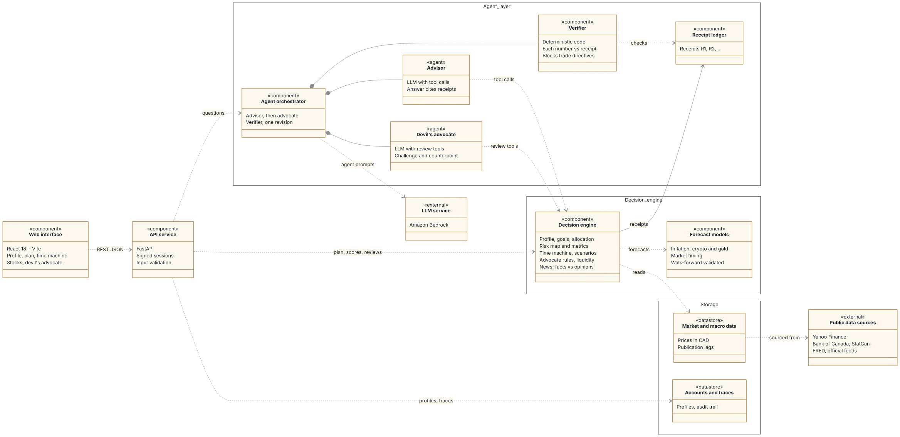
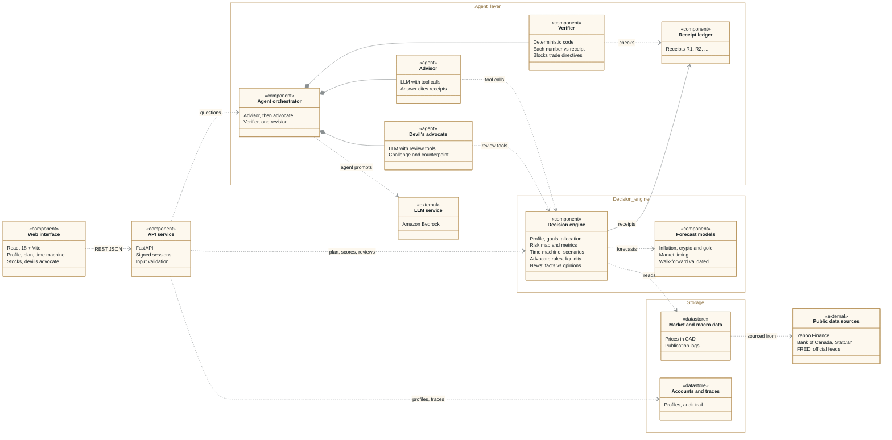

# WealthPilot · Solution architecture

*Explainable, agentic investment simulation. UML component diagram.* Educational simulation: fictitious allocations, no real trades, not personalized financial advice.

PDF one-pager: [WealthPilot_Solution_Architecture.pdf](architecture/WealthPilot_Solution_Architecture.pdf)

Mermaid source of this diagram (validated: parses, no label cut)

## Layers

- **Web interface** (React 18 + Vite): profile, plan, time machine, stocks, devil's advocate.
- **API service** (FastAPI): signed sessions, validated inputs, one endpoint per screen.
- **Decision engine** (deterministic Python): profile = lower of risk capacity and tolerance (5 levels); each goal capped by its horizon; rule-based allocation; six-risk map; time machine and shocks; devil's advocate rules; data-coverage and liquidity rules; news facts vs opinions.
- **Forecast models**: inflation (ridge vs simple rules), crypto and gold (gradient boosting vs the historical mean), market timing (logistic regression). Shown only as far as their walk-forward tests, fixed in advance, allow.

## Why each agent exists

- **Advisor** (LLM): turns tool results into an answer at the investor's level. It does not compute: every figure comes from a tool.
- **Devil's advocate** (LLM): challenges the request and the draft (concentration, horizon, recency, hype) and states the counterpoint when the data supports the investor.
- **Verifier** (code, not an LLM): checks every number against its receipt; blocks trade directives, guaranteed returns and certainty. No model approves its own answer.
- **Orchestrator**: fixed order, at most one revision; remaining problems are shown, not hidden.

## One question, end to end

1. The interface sends the question with the signed session.
2. The API loads the investor's profile and simulated plan.
3. The Advisor calls tools; each result is a numbered receipt (R1, R2, ...).
4. The Devil's advocate reviews the draft with its own tools.
5. The Verifier compares every figure with its receipt.
6. Answer, receipts and verification are shown, and stored as an audit trail.

## Data, explainability, limits

- **Data**: Yahoo Finance prices converted to CAD with Bank of Canada rates; Bank of Canada, Statistics Canada and FRED series with publication lags; official news read within robots.txt.
- **Explainability**: facts, planning assumptions (FP Canada/IFP 2026) and scenarios are labelled; a model that fails its test shows "Not scored"; assets without enough data are not reviewed.
- **Limits**: five years of starter prices, survivorship bias, incomplete ESG coverage, model uncertainty.

*Grounded in: web/src, wealthpilot/api.py, wealthpilot/agents/ (orchestrator, tools, verifier, ledger), profile.py, goals.py, strategist.py, risks.py, time_machine.py, advocate.py, coverage.py, news.py, macro_news.py, inflation.py, forecast.py, timing.py, data.py, accounts.py.*
